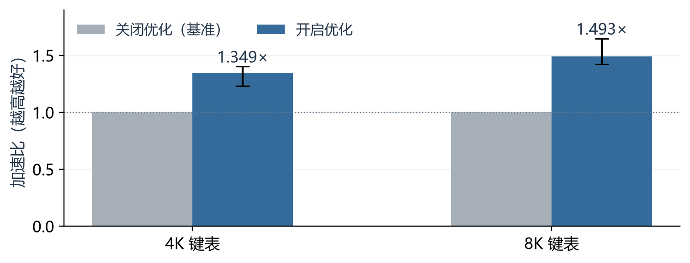
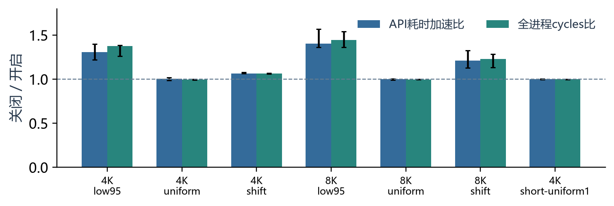
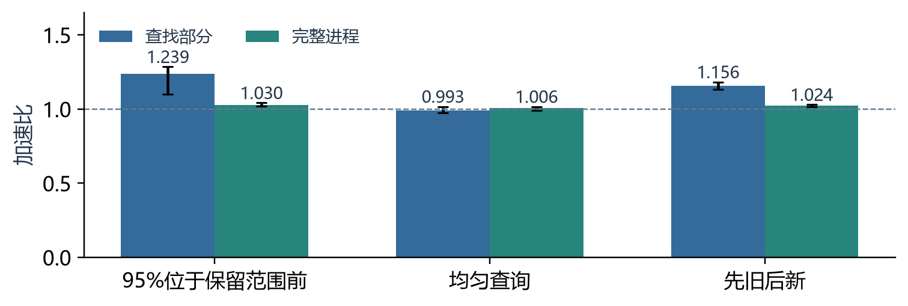

# LLVM BOLT中的自适应CMOV优化

系统优化课程设计说明 · 图文版 · 2026年11月13日

基线：2026年11月2日LLVM main；优化选项：-cmov-branchify-runtime，默认关闭。

## 1 问题描述

以日志时间索引为例：系统在有序时间表中，用lower_bound查找某个时间戳的起始位置。若索引只保留最近的数据，而一批请求大多来自更早的时间，比较就会反复偏向同一侧。下面用[8,16,24,32]和旧时间0说明查找过程。


图1 时间索引查找示例；用于说明问题，并非生产流量测量

查找0时，依次与24、16、8比较，每次都向左，最后返回位置0。若多数请求都落在最早记录之前，分支方向就容易预测。请求改成窗口内混合时间戳后，比较方向会变化，原来的选择可能不再有利。

CMOV按条件选择值，可以减少难预测分支。但在二分查找中，下一次访问地址又依赖这次选择；如果分支方向稳定，处理器可能沿预测方向更早执行后续工作。因此，CMOV与分支之间的取舍要结合当前输入实测。

## 2 优化设计


图2 整体结构：离线生成程序，运行时处理当前输入

原CMOV实现记为A，分支副本记为B。BOLT负责筛选位置、生成B和执行选择入口；生成后的程序自己完成A/B判断。用户开启选项，并不意味着所有候选或所有调用都会执行B。LLVM已有基础CMOV转分支方法，本项目的工作集中在BOLT的组级改写、双版本选择和批次入口处理。

<!-- pagebreak -->

## 2.1 为什么分成多层判断

每层判断回答的问题不同。静态检查解决“能否正确改写”，采样解决“是否有机会”，独立校准解决“候选实测是否更快”，运行时判断解决“当前输入是否仍适合”。这样可以把不合适的情况尽量挡在成本较低的阶段。

| 判断层次 | 依据与作用 |
|---|---|
| 静态合法性 | 循环内2～4条同条件、纯寄存器CMOV；局部编码不增长；内核及批次入口满足复制和调用条件。 |
| 离线采样 | 至少1万次条件样本，主导方向占比至少95%。这里只说明值得试验，不直接批准正式转换。 |
| 独立校准 | 用不同于训练的输入对照候选与关闭版，要求收益比95%区间下界至少1.02，留出收益余量。 |
| 当前调用 | 先测最多3对A/B，每对都显示B快至少10%才准入，防止训练分布与当前输入不符。 |

“95%偏置”统计的是目标条件比较的真假次数，不等同于“95%的请求在时间窗口之前”。一次请求会执行多次比较，输入分布和指令条件分布需要分别记录。训练、校准和测试因此使用分开的输入。

运行时A和B依次处理相邻的真实批次，不重复计算同一批。假设A用100 μs、B用85 μs，这一对通过；若B用95 μs，则放弃准入，把后续批次交给A。这样留出收益余量，但判断依赖相邻批次工作量可比较，所以后面仍要持续检查。


图3 一次调用内的执行选择

图中的直接返回路径需要事先通过指令证明；普通任务还要求至少512批、每批4096条查询。这是为摊薄检查和计时成本设置的保守门槛。达不到形状门槛时使用A，通过形状检查后也仍需实测准入。

<!-- pagebreak -->

## 2.2 使用B之后怎样保护性能

进入B后继续比较成本，因为同一次调用中的输入也可能变化。持续执行时，每两批B共用起止计时，将成本折算为每批；每执行16批B，安排下一批真实工作给A，更新参照成本。这些A批次本来就需要处理，不是把已经完成的任务重算一遍。

如果最近三组B的中位成本达到参照A的95%，说明B已没有足够的收益余量。程序先测当前A；若仍显得不利，再用另外两批A取中位数确认，减少单个偶然偏快样本的影响。确认后，本次调用剩余工作使用A，不再反复试探。下一次调用重新判断。

合并计时减少了读钟次数，也使最近三组观察覆盖最多六批B，输入突变时可能更晚发现。因此必须用分布切换负载验证这一取舍，而不能只看稳定输入的最好成绩。

## 3 实现细节

下面摘取真实实现的核心部分，省略外围代码。CMOVBranchify.cpp先在副本中将同一条件的CMOV依次改成MOV，再由外围条件跳转决定是否执行整组MOV。顺序保持不变，以保留组内寄存器依赖关系；原实现A继续保留。

```cpp
for (MCInst &Inst : *Moves) {
  unsigned CC;
  const bool Converted =
      MIB.convertConditionalMoveToMove(Inst, CC);
  assert(Converted && CC == S.CC);
}
```

cmov_observe.cpp中的Measured执行真实批次、累加结果并推进内部游标。下面的判断表示：计时失败就回退；如果B耗时已经达到A的90%，也放弃这次准入。外围循环最多检查3对，全部通过后才持续使用B。

```cpp
if (!Measured(Original, Reference)) return Fallback(1);
if (!Measured(Branch, Trial)) return Fallback(1);
if (above_ratio(Trial, Reference, 90))
  return Fallback(2);
```

### 3.1 为什么空表可以直接完成

本接口把各批次的查找位置累加为一个结果。若机器指令证明空索引时内核返回0，且该路径没有写内存、调用等副作用，那么任意批数的贡献都为0，可以在入口一次返回。全空查询也按同样原则处理。未知前缀或不同返回常量保留原代码。

入口先处理空批次和空查询，只有确实需要时才访问共享上下文；已证明为0的查询前缀直接跳过。共享输入在调用期间只读，计数器单独存放。时钟异常时，运行库从尚未处理的位置继续，避免重复或丢失工作。

<!-- pagebreak -->

## 4 实验验证与结果解析

平台为Ryzen 7 7735H、WSL2、Linux x86-64，绑定来宾逻辑CPU 2。它是来宾CPU亲和性，不代表独占宿主物理核心。负载由Clang 18正常-O3编译；开关版使用相同输入和通用BOLT参数，通过本功能选项作比较。


图4 实验流程

正式矩阵包含2种键表规模×26种常规场景，以及7项边界，共59项、31轮、14632次计时执行。每个配对块交错执行开关版及参照，减少先后顺序影响。保留全部样本，用配对耗时比中位数及逐项95%区间报告结果。训练和独立校准不使用正式测试输入。

### 4.1 强偏置场景为什么有收益



图5 强偏置查找的加速比；误差线为逐项95%区间

| 键表大小 | 加速比 | 95%区间 |
|---|---|---|
| 4K | 1.349倍 | [1.232, 1.402] |
| 8K | 1.493倍 | [1.425, 1.648] |

加速比=关闭选项耗时÷开启选项耗时。1.349倍表示原来100 ms的任务约用74.1 ms完成，而不是耗时减少34.9%。本组4K和8K任务分别减少约25.86%和33.01%的耗时，区间均高于1，支持目标场景下存在收益。

强偏置使分支方向更稳定，程序也更容易通过A/B准入。8K在这组数据中收益更高，可能与查找深度和执行依赖等有关；本次没有把这些因素逐一隔离，不能据此推导键表越大就一定越快。多数不适合的负载接近1倍，则对应保护策略保留原实现的目标。

<!-- pagebreak -->

## 4.2 怎样看无收益场景与回退


图6 常规负载的耗时变化；右侧放大接近0%的区域

纵轴为耗时增幅，负值表示更快，虚线为1%参考线。52项常规负载中，51项中位回退低于1%，最大为4K threshold513的1.10%。均匀输入未进入持续B阶段，但仍有准入试探和分发成本，所以接近1倍不等于严格没有开销。静态拒绝路径另用可执行节一致性检查验证。

临界负载又用新种子、每次累计四次独立调用作长计时补测。threshold512/513的中位回退约0.17%和0.21%，区间支持约1%的参考。补测增加了精度信息，但不覆盖主矩阵的1.10%记录，也不能证明未来任意输入都无回退。

### 4.3 空表的大倍率表示什么


图7 空表调用耗时中位数；纵轴为对数坐标

空表512批和1024批调用开启后均约4 ns，单批约4.04 ns。关闭版仍逐批调用内核，开启版则利用整批结果为0的证明，省去这些调用和运行时观察。这里优化的是可消除的工作量，不能把大倍率当作普通查找的加速，也不宜与图5混成一个平均成绩。

<!-- pagebreak -->

## 4.4 perf说明了什么

先重跑140次WSL perf检查，9项必需检查通过；再测最终版7项负载、9轮配对，共252次perf stat，输出全部一致。四项用户态硬件事件成组采集，运行占比均100%。这些检查支持本环境中所列计数器的一致性，不代表原生Linux的绝对精度。



图8 perf补测：API耗时与全进程cycles比分列

| 观察量 | 怎样理解 |
|---|---|
| cycles | 处理器周期数，可辅助观察CPU执行成本；这里统计整个进程。 |
| instructions | 退休指令数。更多指令仍可能通过更好的执行重叠获得更低周期数。 |
| branches / branch-misses | 分支数量与预测失误数量。变换会增加分支，不能只凭失误率的分母变化判断好坏。 |

4K/8K强偏置的API加速约1.31/1.41倍，cycles比约1.37/1.44。硬件计数包含准备和同模式预热，API计时只覆盖程序原有的测量区间。因此它们是不同范围的观察；本次也使用了不同重复次数，不能直接替换31轮正式矩阵。

4K强偏置中，开启后的指令数和分支失误反而更多，但cycles减少。合理的解释是，稳定分支让处理器有机会更早执行后续工作，抵消了新增分支的代价；本次尚未直接测量流水线等待原因，不能将其确定为唯一机制。至少可以排除“提速一定来自指令或失误减少”的简单说法。

优化后程序的默认采样符号显示出现异常，部分地址被误标为_start。已结合内存映射、ELF加载段和符号地址区间复核：关闭版934个样本中924个位于原内核；开启版794个样本中460个位于原内核、322个位于分支副本。未解析部分单列。

<!-- pagebreak -->

## 4.5 简单业务场景是否有整体收益

原型读取Loghub Linux 2k公开日志，建立有序时间索引。对于一组时间阈值，lower_bound的位置就是严格早于该阈值的事件数；程序将这些数量汇总输出。完整流程包含启动、读取和解析文件、排序建索引、批量计算及输出。它不是逐条日志检索工具。



图9 公开日志业务原型：组件与完整进程分开测量

保留2000条日志的时间信息；因数据没有年份，统一按2000年UTC解释。每组2097152条查询由固定种子生成，覆盖95%位于保留范围前、均匀查询和先旧后新的阶段切换。训练、校准、测试分别生成；9轮测试的162次进程输出均与Python bisect参考一致。

范围前查询中，查找部分加速1.239倍，完整进程加速1.030倍，95%区间[1.020,1.042]；切换场景整体1.024倍。均匀查询的整体区间跨过1，未确认收益。区间反映固定数据下的重复计时波动，不包含所有真实请求分布的不确定性。

关闭版中，查找约占完整进程的16.5%，其余大部分花在文件读取和解析等工作。用“其余时间不变”粗略估计，整体加速约为1÷(0.835+0.165÷1.239)=1.033倍，与实测1.030倍接近。这解释了为什么组件收益明显，而完整程序的收益只有几个百分点。

Docker内独立重新生成数据、编译、训练和测量后，范围前查询整体1.020倍，切换场景1.029倍，均匀查询仍未确认收益。两次结果独立保存。该原型使用真实公开日志，但请求是合成的；不能把结果推广到生产流量或成熟日志系统。

范围外查询也可以由应用源码先作边界检查。本次比较的是BOLT对通用查找实现的效果，未证明它优于这种算法改写。数据来自github.com/logpai/loghub；Zhu等，Loghub，ISSRE 2023，按随附许可使用。

<!-- pagebreak -->

## 4.6 正确性与复现

| 验证内容 | 结果 |
|---|---|
| 计时结果校验 | 正式14632次、长计时992次全部通过 |
| 独立功能对照 | 原始、关闭、开启三个版本，共468次结果一致 |
| 零工作路径 | 344个组合；另有两种匹配模式和两种拒绝模式检查 |
| 工具与运行库 | 32项集成、28项安全、755项可运行BOLT回归通过 |
| 自动流程 | Docker重新训练和校准完成8项检查；校准拒绝产物另有156次功能运行通过 |

功能检查分别覆盖改写是否等价、拒绝路径是否保持原代码，以及异常时是否重复或遗漏任务。性能判断则使用完整API或完整进程时间，包含该范围内的观察和回退成本。Zstd、SQLite等成熟应用的历史筛查尚无稳定加速正例，日志原型不能替代这一层验证。

## 5 局限性与后续验证

当前面向Linux x86-64、有明确批次入口的程序，内核只接受受支持的叶函数与指令模式，共享输入须在调用期间只读。其他模式保留原代码。结果来自一台WSL机器，换CPU后需要重新采样、校准和计时。

最有价值的后续工作是扩展独立日志和真实请求分布，检查范围前查询在业务中是否常见；再测试更小的非空任务、更多编译器模式和处理器。既要记录有收益的机会，也要记录被拒绝的位置，才能评价实际覆盖率。

### 运行方法

准备Linux x86-64、Bash、Python3和Docker。入口自动下载并校验镜像，也可从固定源码构建。perf补测及日志原型有独立复现说明。

```bash
./run.sh                 # 快速流程
./run.sh full            # 完整负载与空表实验
./run.sh functional      # 功能和安全检查
./run.sh evidence        # 离线复算保存的数据
./run.sh build --source --jobs 2  # 源码构建
```

| 内容 | 仓库位置 |
|---|---|
| 完整修改 | stage_1/patches/cmov-runtime.patch |
| 文档及补充实验 | stage_1/docs/design.*、perf-application.md |
| 原始数据 | stage_1/evidence/ |
| 负载及原型 | stage_1/project/cmov_runtime/、experiments/ |

源码固定提交为3bd152ddbb6df45e0e07d6c9e9eb1573dcfd3dc6。上游覆盖复核记录截至2026年11月12日。代码与文档整理使用AI辅助，实验数据来自实际运行记录。
