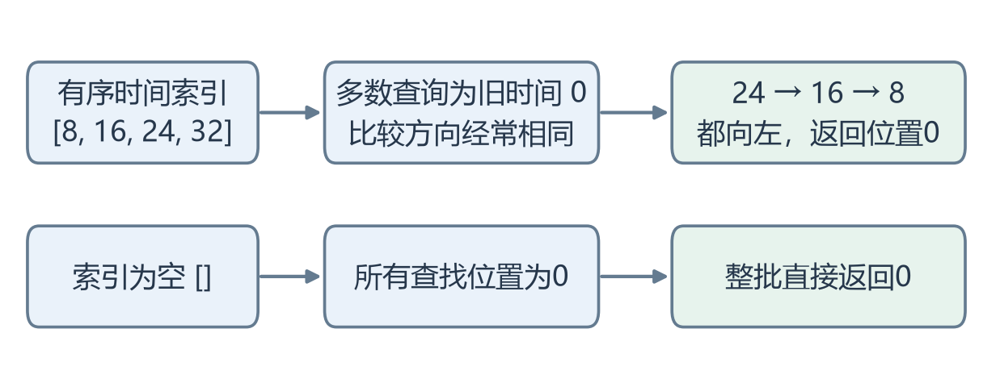
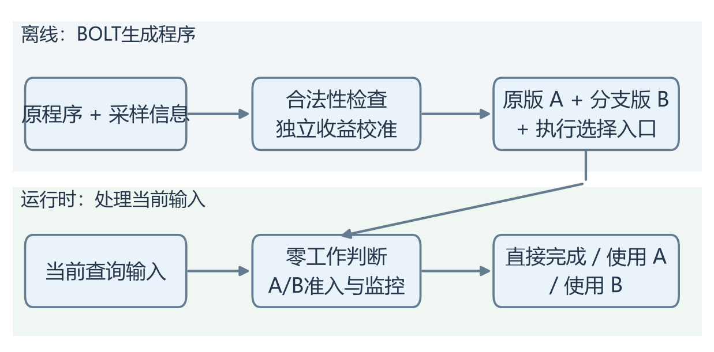
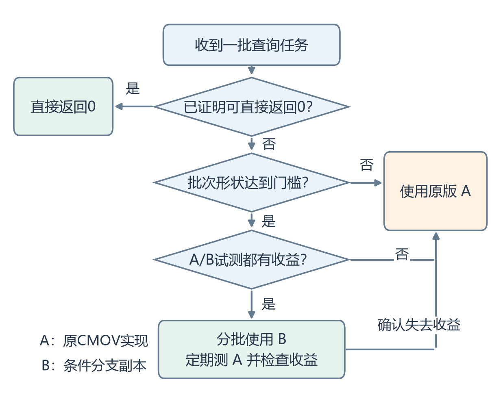
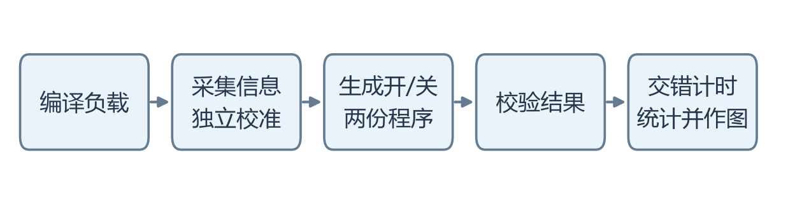
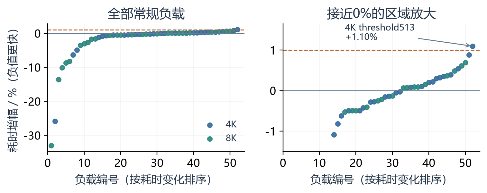
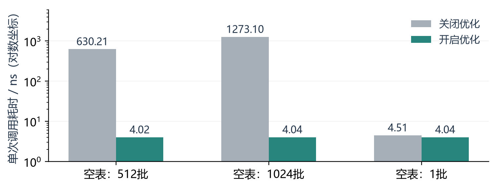

# LLVM BOLT中的自适应CMOV优化

系统优化课程设计说明 · 简洁版 · 2026年11月13日

基线：2026年11月2日LLVM main；优化选项：-cmov-branchify-runtime，默认关闭。

## 1 问题描述

以日志时间索引为例：系统在有序时间表中，用lower_bound查找某个时间戳的起始位置。若索引只保留最近的数据，而一批请求大多来自更早的时间，比较就会反复偏向同一侧。下面用[8,16,24,32]和旧时间0说明查找过程。



图1 时间索引查找示例；用于说明问题，并非生产流量测量

CMOV按条件选择值，可以减少难预测的分支；比较方向长期相同时，条件分支可能更快。请求改成窗口内混合时间戳后，方向会变化，需要重新判断；索引为空时则能直接确定结果为0。我们保留两种实现，在当前任务上比较成本，并让零工作输入提前完成。

## 2 优化设计



图2 整体结构：上层生成程序，下层处理当前输入

原版记为A，分支版记为B。核心思路有三点：先确认候选值得优化；运行时继续观察收益；确认结果为0的任务直接完成。LLVM已有基础CMOV转分支方法，本项目的新增工作是BOLT中的组级改写、双版本选择和批次入口处理。

静态检查要求：循环内2～4条同条件寄存器CMOV，局部编码不增长；至少1万样本、95%偏置；独立校准收益比区间下界至少1.02。程序须有明确批次入口、共享只读输入及受支持的叶内核。

<!-- pagebreak -->

## 2.1 运行时如何选择



图3 一次调用内的执行选择

普通任务要求至少512批、每批4096条查询。准入时最多比较3对A/B，三对都显示B快至少10%才使用B；之后每两批B合并计时，并定期测A。收益变小时重新测A确认，确认后本次调用剩余工作使用A。

## 3 实现细节

下面摘取两个真实实现片段，省略外围代码。第一个位于CMOVBranchify.cpp：在分支副本中将同一条件的CMOV依次改成MOV，再由外围条件跳转决定是否执行这一组MOV。原来的寄存器赋值顺序保持不变。

```cpp
for (MCInst &Inst : *Moves) {
  unsigned CC;
  const bool Converted =
      MIB.convertConditionalMoveToMove(Inst, CC);
  assert(Converted && CC == S.CC);
}
```

第二个位于cmov_observe.cpp。Measured执行真实的一批工作并记录耗时；若B耗时达到A的90%，立即放弃这次准入。外围循环检查最多3对，全部通过才进入持续B阶段。

```cpp
if (!Measured(Original, Reference)) return Fallback(1);
if (!Measured(Branch, Trial)) return Fallback(1);
if (above_ratio(Trial, Reference, 90))
  return Fallback(2);
```

零工作入口还会检查真实指令是否证明返回0，匹配后才生成直接完成路径；未知前缀保留原代码。空查询不读取未使用的上下文。持续B阶段定期重测A，确认收益不足后，剩余任务回到A。

<!-- pagebreak -->

## 4 实验验证

平台为Ryzen 7 7735H、WSL2、Linux x86-64，绑定来宾逻辑CPU 2。测试负载是Clang 18正常-O3编译的批量lower_bound查找。基准和优化版使用相同输入、相同通用BOLT参数，通过选项开关作比较。



图4 实验流程

训练和校准与正式测量分开。正式实验覆盖52项常规负载和7项边界，共31轮；每轮交错执行并检查输出。以每轮配对耗时比的中位数作为结果，图中误差线为逐项95%区间。

正式加速比来自完整调用的配对计时，运行库内部使用线程CPU时间。前期做过perf一致性检查；当前正式版本未用perf事件计数作为收益或原因证明。

### 4.1 有收益的负载


图5 强偏置查找的加速比；越高越好

| 键表大小 | 开启后的加速比 | 95%区间 |
|---|---|---|
| 4K | 1.349倍 | [1.232, 1.402] |
| 8K | 1.493倍 | [1.425, 1.648] |

加速比=关闭选项耗时÷开启选项耗时。主要正例中，4K和8K任务分别减少约25.86%和33.01%的耗时。强偏置和部分分布切换负载有收益；均匀输入、短调用和准入混淆输入用于检查保护成本。

<!-- pagebreak -->

## 4.2 无收益负载与空表



图6 52项常规负载的耗时变化；虚线为1%参考线

常规负载中，51/52项的中位回退低于1%，最大为4K threshold513的1.10%。独立长计时补测中，threshold512/513分别回退约0.17%和0.21%，区间支持约1%的参考。两套数据分别保存，主矩阵保持完整。



图7 空表调用耗时中位数；纵轴使用对数坐标

空表512批和1024批调用开启后均约4 ns，单批空表约4.04 ns。大批空表的结果能整批确定为0，因此省去了内核调用和计时。这个收益对应零工作路径；普通查找的效果见图4。

<!-- pagebreak -->

## 4.3 正确性与复现

| 验证内容 | 结果 |
|---|---|
| 计时过程中的结果校验 | 正式14632次执行、独立长计时992次执行全部通过 |
| 独立功能对照 | 原始、关闭、开启三个版本，共468次运行结果一致 |
| 零工作路径 | 344个组合通过；另检查两种匹配模式和两种拒绝模式 |
| 工具与运行库 | 32项集成、28项安全检查、755项可运行BOLT回归通过 |
| 交付流程 | Docker中重新训练、校准并完成8项流程；校准拒绝产物另有156次功能运行通过 |

真实应用方面，曾探索Zstd、SQLite等完整程序，尚未确认稳定的应用级加速；这些历史筛查不能替代最终版的应用验证。当前主要收益属于查找组件。

## 5 局限性

当前面向Linux x86-64和有明确批次入口的程序，内核只接受受支持的叶函数与指令模式。共享输入须在一次调用期间保持只读。其他模式保留原代码。

结果来自一台WSL机器；换CPU后需要重新采样、校准和计时。当前常规最差中位回退为1.10%，还应继续扩展更小的非空任务及其他程序，验证保护成本。

### 运行方法

准备Linux x86-64、Bash、Python3和Docker。仓库入口会下载并校验预编译镜像，也可从固定源码构建。

```bash
./run.sh                 # 快速流程
./run.sh full            # 完整负载与空表实验
./run.sh functional      # 功能和安全检查
./run.sh evidence        # 离线复算保存的数据
./run.sh build --source --jobs 2  # 从源码构建
```

### 提交文件与数据位置

| 内容 | 仓库位置 |
|---|---|
| 完整修改 | stage_1/patches/cmov-runtime.patch |
| 设计文档 | stage_1/docs/design.docx、design.pdf、design.md |
| 统计和原始记录 | stage_1/evidence/final/、precision/ |
| 负载与脚本 | stage_1/project/cmov_runtime/ |

源码固定提交为3bd152ddbb6df45e0e07d6c9e9eb1573dcfd3dc6。基础CMOV转换已有LLVM实现，上游覆盖复核记录截至2026年11月12日。代码与文档整理使用AI辅助，实验数据由实际运行记录生成。
