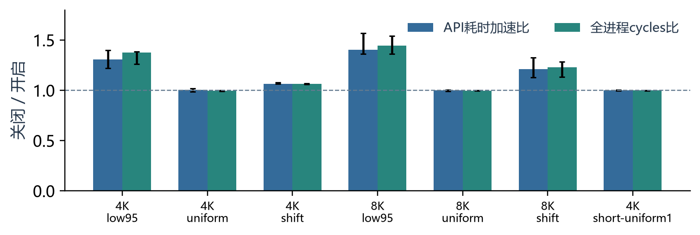
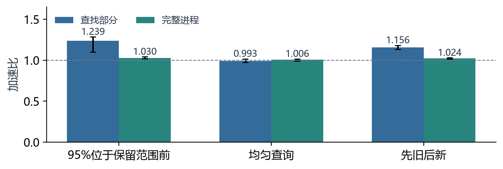

# 最终版perf与公开日志场景实验

本次使用最终版BOLT与冻结的开/关二进制。新数据独立保存，原31轮正式矩阵保持原值。

## 1. perf是否可靠

先重新执行已知指令循环、分支、睡眠、跨来宾CPU与进程隔离检查：140次perf stat的9项必需检查全部通过，cycles采样检查也通过。来宾CPU绑定不等于物理核独占，检查不证明与原生Linux绝对计数一致。

## 2. 最终版perf结果

事件为cycles:u、instructions:u、branches:u、branch-misses:u，四项成组采集，运行占比全部为100%。7个单元、9个配对块、252次perf stat，全部输出校验一致。每块随机ABBA/BAAB，保留全部样本。

硬件事件覆盖整个进程，包含输入准备、参考计算及同模式预热；程序JSON计时只覆盖原有API测量区间。因此下表分列API耗时比与全进程cycles比，不把硬件计数说成精确ROI计数。比值为关闭版/开启版，大于1表示后者更快或计数更少。

| 键表 | 输入 | API加速比 | cycles比 | instructions比 | branch-misses比 |
|---|---|---|---|---|---|
| 4096 | low95 | 1.3093 | 1.3749 | 0.9446 | 0.2565 |
| 4096 | uniform | 1.0038 | 0.9981 | 1.0000 | 0.1424 |
| 4096 | shift | 1.0655 | 1.0656 | 0.9844 | 0.3788 |
| 8192 | low95 | 1.4063 | 1.4441 | 0.9495 | 0.7567 |
| 8192 | uniform | 0.9989 | 0.9976 | 1.0000 | 0.1210 |
| 8192 | shift | 1.2095 | 1.2305 | 0.9861 | 1.8752 |
| 4096 | short-uniform1 | 0.9997 | 0.9988 | 0.9999 | 0.9807 |

4K强偏置中，开启后指令数和分支失误反而更多，而cycles减少、API更快。因此不能把收益概括成“分支失误减少”。这些观察与条件分支改变依赖链和执行方式的解释相符，但尚不足以唯一确定微架构原因。均匀输入也可能增加少量试探分支失误，而整体时间接近1倍。

采样的默认符号化将部分优化后地址误显示为_start。已按PERF_RECORD_MMAP2、ELF PT_LOAD和nm -S区间独立映射：关闭版934个样本中924个位于原内核；开启版794个样本中460个位于原内核、322个位于分支副本。其他样本单列，不将未解析地址强行归到某个函数。

原始计数、完整argv、校验结果和标签修正记录位于perf证据目录。采集程序曾被JSON中的guarded字段覆盖开/关标签，已从逐次保存的可执行文件argv恢复；未改动计数、耗时或样本。原始未修正JSONL另存。

## 3. 简单应用场景：日志累计计数

数据来自[Loghub Linux 2k](https://github.com/logpai/loghub/tree/dd61d0952749ee7963bde24220d1be5ede023033/Linux)，保留2000条记录的时间信息。工具读取日志、建立有序时间索引、读取查询阈值，输出“所有阈值之前的日志条目数量总和”。这与按时间阈值统计历史事件数量相对应，不提供逐条检索结果。

日志没有年份，实验统一指定2000年UTC；查询由固定种子生成，每组2097152条，包括95%位于保留范围前的查询、窗口内均匀查询，以及先旧后新的阶段切换。训练、校准、测试的查询分别生成。它是使用真实公开数据的业务原型，不是成熟系统测试或生产查询回放。

Clang 18正常O3编译，使用同一个BOLT选项和原有阈值；独立校准以批次计算耗时为依据并实际通过。9个配对块，同时保留关闭自对照；162次测试进程全部与Python bisect参考结果一致。

| 查询场景 | 查找部分加速比 | 完整进程加速比 | 完整进程95%区间 | 开启版准入次数 |
|---|---|---|---|---|
| past95 | 1.2394 | 1.0297 | [1.0198, 1.0424] | 18/18 |
| uniform | 0.9929 | 1.0062 | [0.9920, 1.0168] | 0/18 |
| shift | 1.1560 | 1.0242 | [1.0160, 1.0304] | 18/18 |

完整进程计时包括启动、读取/解析、排序建索引、查询和结果输出；数据生成及参考计算在计时外。关闭版中查找约占完整进程的16.5%，所以组件约1.24倍的收益被摊薄为整体约3%。均匀查询的整体区间跨过1，未确认加速。

另在已发布Docker镜像中重新生成数据、编译、训练、独立校准并重测。范围前查询的完整进程加速为1.0203倍，区间[1.0049,1.0417]；切换场景1.0292倍，区间[1.0191,1.0347]；均匀场景区间仍跨过1。该复现独立保存，不替换初次数据。

## 4. 使用范围

日志保留窗口之外的大批历史阈值，是目前可用的简单场景候选。结论限于这份数据和合成请求，应继续测试不同日志量、真实请求分布和更多独立数据文件。若应用本身先判断阈值是否落在索引范围之外，也可能直接解决这类工作；本次没有证明BOLT优于该源码算法改写。

已有Zstd、SQLite等成熟应用的历史筛查未确认稳定收益。本次原型正例不能替代最终版在成熟系统中的验证。

## 数据来源

Loghub: https://github.com/logpai/loghub 。Jieming Zhu et al., “Loghub: A Large Collection of System Log Datasets for AI-driven Log Analytics”, ISSRE 2023。数据使用与再分发遵循随附LICENSE.loghub。
