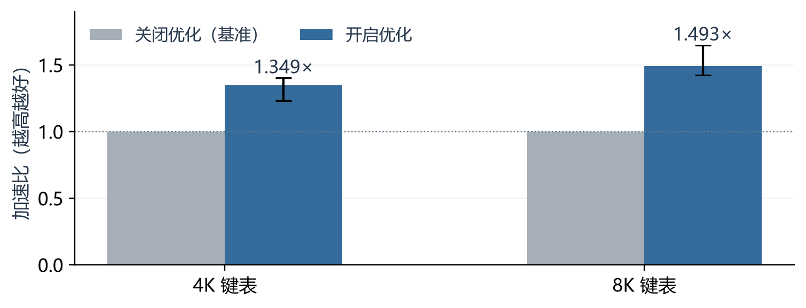
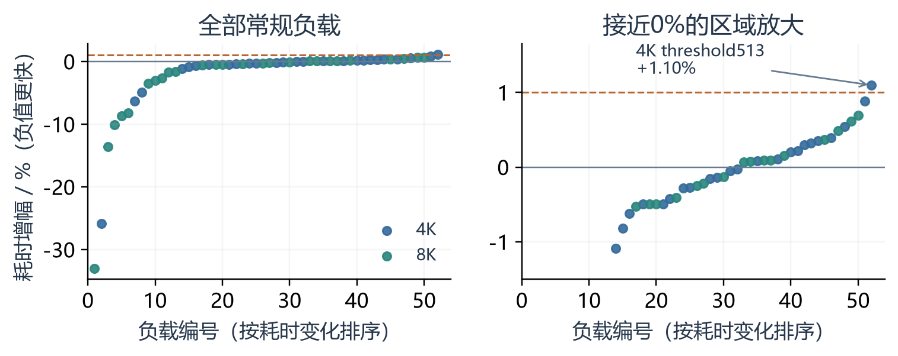
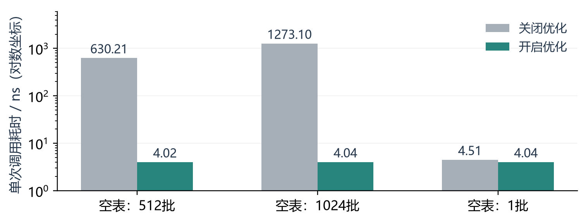

# 实验结果

对照为相同通用BOLT参数下的选项关闭版。加速比为关闭版耗时除以开启版耗时，区间为逐项95%区间。

59项×31轮，共14632次执行全部校验通过。常规51/52项中位回退低于1%，最差1.10%；7/7边界低于1%。独立长计时临界两项约0.17%/0.21%，与主矩阵分别保存。

## 逐项结果

| 键表条目数 | 场景 | 加速比 | 95%区间 | 耗时增幅 |
|---|---|---|---|---|
| 4096 | low95 | 1.3488 | [1.2320, 1.4020] | -25.8600% |
| 4096 | high95 | 1.0522 | [1.0460, 1.0832] | -4.9568% |
| 4096 | low80 | 1.0063 | [0.9995, 1.0153] | -0.6218% |
| 4096 | uniform | 0.9989 | [0.9924, 1.0045] | +0.1072% |
| 4096 | sorted | 0.9968 | [0.9898, 1.0058] | +0.3198% |
| 4096 | shift | 1.0670 | [1.0527, 1.0784] | -6.2836% |
| 4096 | long-recovery | 0.9978 | [0.9927, 1.0016] | +0.2208% |
| 4096 | fast-shift | 1.0016 | [0.9955, 1.0062] | -0.1560% |
| 4096 | short-uniform1 | 0.9965 | [0.9893, 1.0067] | +0.3561% |
| 4096 | short-uniform4 | 1.0083 | [0.9990, 1.0137] | -0.8191% |
| 4096 | short-uniform16 | 0.9971 | [0.9904, 1.0056] | +0.2947% |
| 4096 | short-low95 | 1.0028 | [1.0001, 1.0094] | -0.2773% |
| 4096 | short-uniform63 | 1.0003 | [0.9892, 1.0024] | -0.0253% |
| 4096 | threshold64 | 1.0028 | [0.9845, 1.0101] | -0.2755% |
| 4096 | threshold65 | 0.9961 | [0.9860, 1.0105] | +0.3911% |
| 4096 | fast-shift1 | 1.0049 | [1.0007, 1.0087] | -0.4911% |
| 4096 | low50 | 1.0042 | [1.0007, 1.0097] | -0.4205% |
| 4096 | hot-prefix | 0.9991 | [0.9924, 1.0041] | +0.0879% |
| 4096 | hot-suffix | 0.9980 | [0.9871, 1.0046] | +0.2023% |
| 4096 | shift-high | 1.0110 | [1.0012, 1.0172] | -1.0917% |
| 4096 | striped | 1.0050 | [0.9957, 1.0110] | -0.4956% |
| 4096 | threshold511 | 1.0005 | [0.9916, 1.0038] | -0.0521% |
| 4096 | threshold512 | 0.9912 | [0.9892, 1.0005] | +0.8856% |
| 4096 | threshold513 | 0.9891 | [0.9802, 0.9989] | +1.0970% |
| 4096 | early-shift | 0.9946 | [0.9891, 0.9964] | +0.5404% |
| 4096 | calibration-alias | 1.0013 | [0.9951, 1.0049] | -0.1337% |
| 8192 | low95 | 1.4928 | [1.4250, 1.6479] | -33.0137% |
| 8192 | high95 | 1.0948 | [1.0648, 1.1311] | -8.6580% |
| 8192 | low80 | 1.0267 | [1.0234, 1.0361] | -2.6022% |
| 8192 | uniform | 0.9963 | [0.9912, 1.0065] | +0.3688% |
| 8192 | sorted | 0.9931 | [0.9895, 1.0077] | +0.6910% |
| 8192 | shift | 1.1570 | [1.1022, 1.2013] | -13.5706% |
| 8192 | long-recovery | 1.0177 | [1.0063, 1.0466] | -1.7415% |
| 8192 | fast-shift | 1.0889 | [1.0455, 1.1178] | -8.1680% |
| 8192 | short-uniform1 | 1.0041 | [0.9892, 1.0058] | -0.4106% |
| 8192 | short-uniform4 | 1.0013 | [0.9944, 1.0092] | -0.1299% |
| 8192 | short-uniform16 | 1.0025 | [0.9988, 1.0171] | -0.2501% |
| 8192 | short-low95 | 1.0361 | [1.0128, 1.0884] | -3.4813% |
| 8192 | short-uniform63 | 0.9993 | [0.9939, 1.0072] | +0.0710% |
| 8192 | threshold64 | 0.9951 | [0.9855, 1.0055] | +0.4911% |
| 8192 | threshold65 | 1.0053 | [0.9973, 1.0129] | -0.5255% |
| 8192 | fast-shift1 | 1.1121 | [1.0527, 1.1384] | -10.0781% |
| 8192 | low50 | 1.0049 | [0.9994, 1.0092] | -0.4912% |
| 8192 | hot-prefix | 1.0050 | [0.9962, 1.0150] | -0.4936% |
| 8192 | hot-suffix | 0.9991 | [0.9928, 1.0118] | +0.0924% |
| 8192 | shift-high | 1.0166 | [1.0109, 1.0267] | -1.6292% |
| 8192 | striped | 1.0311 | [1.0232, 1.0681] | -3.0121% |
| 8192 | threshold511 | 1.0022 | [0.9952, 1.0044] | -0.2146% |
| 8192 | threshold512 | 0.9991 | [0.9911, 1.0060] | +0.0898% |
| 8192 | threshold513 | 0.9939 | [0.9878, 1.0005] | +0.6156% |
| 8192 | early-shift | 0.9984 | [0.9923, 1.0055] | +0.1583% |
| 8192 | calibration-alias | 0.9992 | [0.9929, 1.0050] | +0.0762% |
| 0 | low95 | 157.4978 | [155.9849, 158.7606] | -99.3651% |
| 0 | uniform | 315.7606 | [312.2280, 319.0396] | -99.6833% |
| 0 | short-uniform1 | 1.1207 | [1.0999, 1.1256] | -10.7721% |
| 1 | low95 | 1.0024 | [0.9981, 1.0150] | -0.2437% |
| 1 | uniform | 0.9984 | [0.9904, 1.0096] | +0.1574% |
| 1 | short-uniform1 | 1.0069 | [0.9850, 1.0326] | -0.6841% |
| 64 | low95 | 1.1104 | [1.0930, 1.1315] | -9.9424% |
